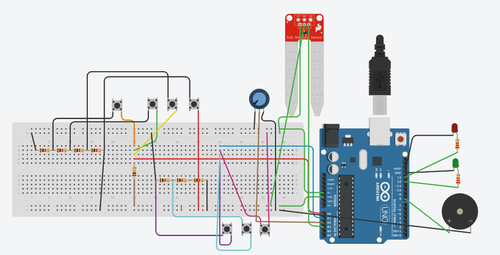

# In-Wall Cable Fault Detection System

A real-time prototype that detects hidden wiring faults in structural walls and underground cables. Built as an ECE team mini project at St. Joseph's Institute of Technology.

## Overview
Hidden wiring faults in walls and underground cables are hard to find and a major electrical maintenance problem. This Arduino-based prototype monitors an in-wall wiring channel and an underground cable channel using resistor-ladder networks (push buttons simulate faults), plus a potentiometer to simulate overcurrent and a soil moisture sensor to detect water ingress. When a fault is detected, it reports the fault type, with a room location for wall faults or an estimated distance for underground faults, and alerts the user with an LED and a buzzer.

## Prototype


Breadboard prototype with Arduino Uno, resistor ladders, push buttons, LEDs and buzzer.

## Circuit Diagram


Circuit diagram drawn in Tinkercad. The simulation does not show serial output, so the real prototype and its output are documented here.

## Components Used
- Arduino Uno
- Resistor ladder networks with push buttons (fault simulation)
- Potentiometer (overcurrent simulation)
- Soil moisture sensor
- Green and red LEDs
- Buzzer

## How It Works
1. The Arduino reads four analog inputs: underground channel (A0), in-wall channel (A1), potentiometer (A2) and soil sensor (A3).
2. It checks them in priority order: overcurrent, underground fault, in-wall fault, then moisture.
3. A fault shows a message on the Serial Monitor: a distance (1 to 4 km) for underground faults or a room location for wall faults.
4. In a fault, the red LED turns on and the buzzer sounds. Otherwise the green LED stays on.

## Sample Serial Monitor Output
Output from the Arduino Serial Monitor (9600 baud) during testing:

```
[ WALL FAULT DETECTED | Loc: Room 3 ]
[ UG FAULT DETECTED | Dist: 4 KM ]
[ System Normal | Status: OK ]
```

The system reports normal status when readings are healthy, and flags wall and underground faults with a location or distance.

## Firmware
Control firmware written in C/C++ for the Arduino, available in this repository as `in-wall-cable-fault-detection-system.ino`.

## My Role
I was involved in all stages of this project: simulating the circuit, building the breadboard prototype, making the connections, and testing it to get the fault detection output on the Serial Monitor.

## Team Project
Developed with my project team as part of our ECE curriculum.
