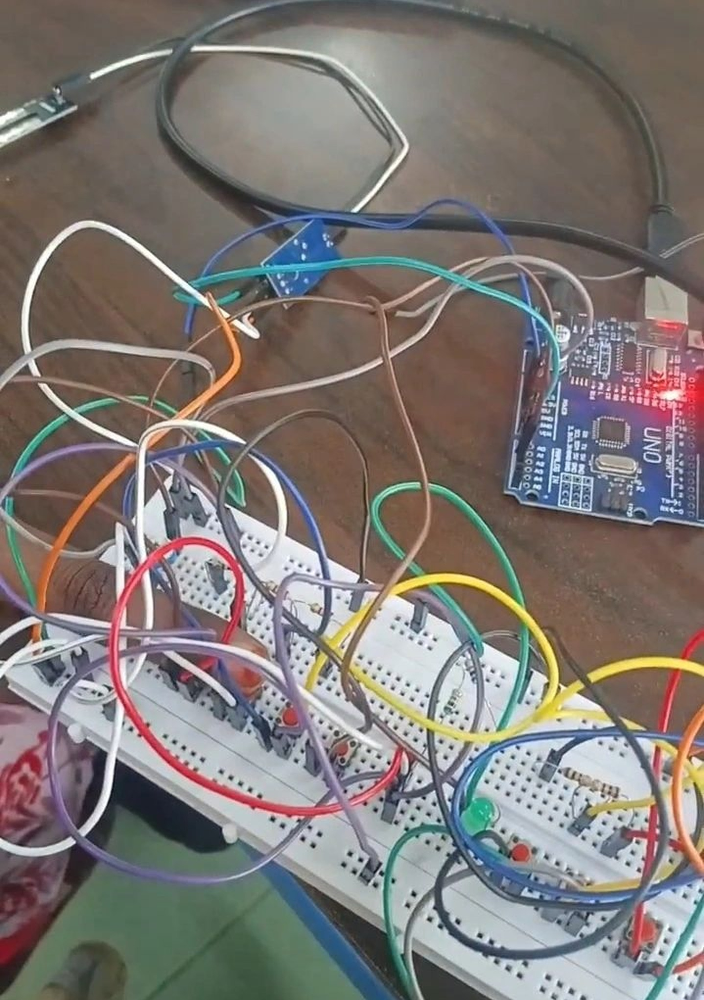

# In-Wall Cable Fault Detection System

A real-time prototype that detects hidden wiring faults inside structural walls. Built as an ECE team mini project at St. Joseph's Institute of Technology.

## Overview
Hidden wiring faults in walls are hard to find and a major electrical maintenance problem. This system uses an Arduino and a resistor-bridge network to detect signal drops across wiring sections, flagging short circuits and open circuits and alerting the user instantly with LEDs and a buzzer. The firmware also reports a fault location for wall wiring and a distance for an underground cable input.



## Components Used
- Arduino Uno
- Resistor network (resistor bridge)
- Push buttons / switches
- LEDs
- Buzzer

## How It Works
1. The resistor-bridge network produces a signal level across each wiring section.
2. The Arduino reads the analog values and checks for drops.
3. A drop is classified as a short-circuit or open-circuit fault.
4. LEDs show the status and the buzzer alerts the user.

## Sample Serial Monitor Output
Output from the Arduino Serial Monitor (9600 baud) during testing:

```
[ WALL FAULT DETECTED | Loc: Room 3 ]
[ UG FAULT DETECTED | Dist: 4 KM ]
[ System Normal | Status: OK ]
```

The system reports normal status when readings are healthy, and flags wall and underground faults with a location or distance.

## Firmware
Control firmware written in C/C++ for the Arduino, available in this repository as `in-wall-cable-fault-detection-system.ino`.

## My Role
I handled the circuit simulation, breadboard assembly and wiring, and testing of the prototype, and verified the fault detection output on the Serial Monitor.

## Team Project
Developed with my project team as part of our ECE curriculum.
